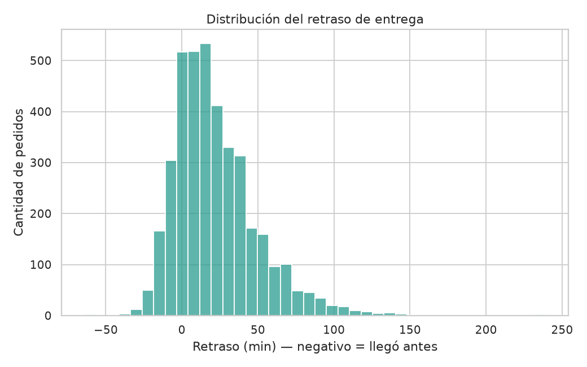
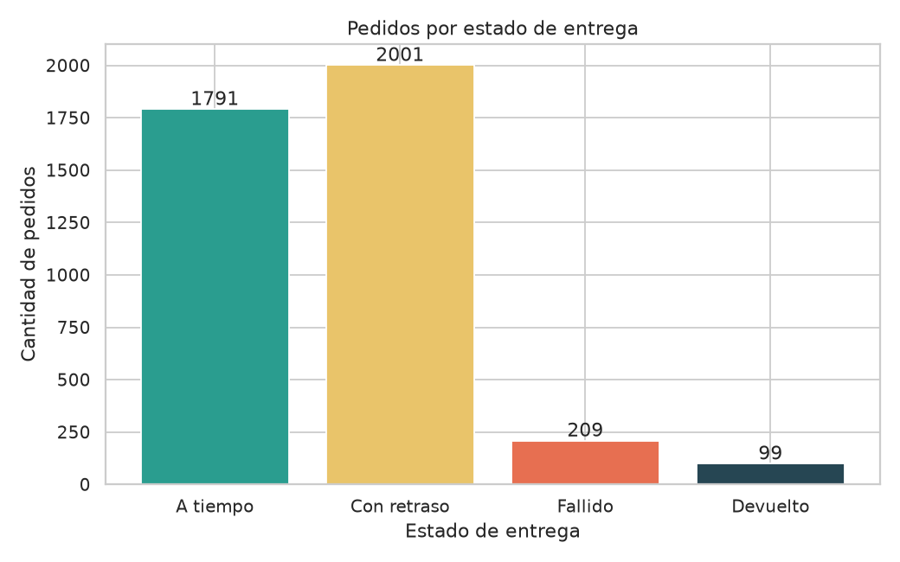
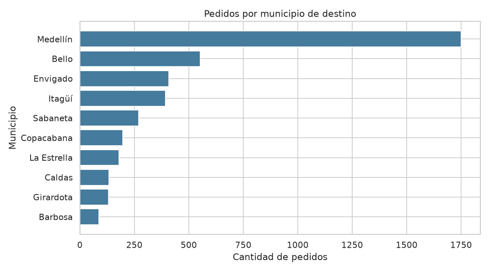
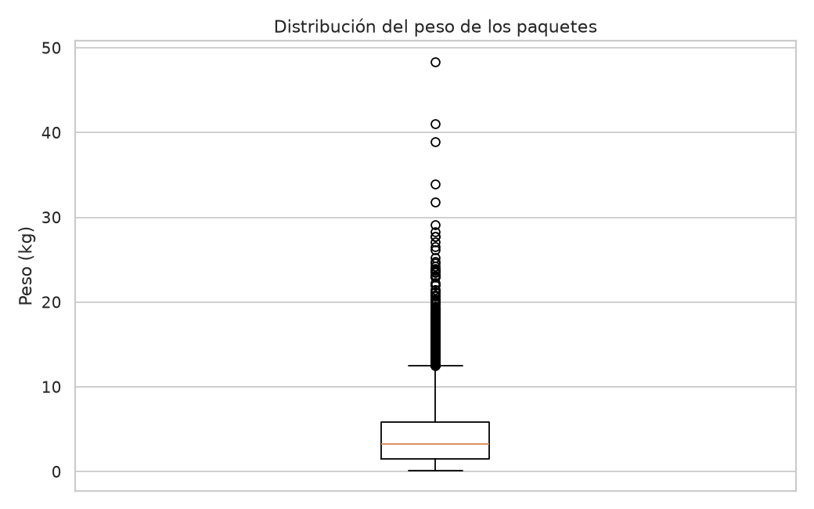
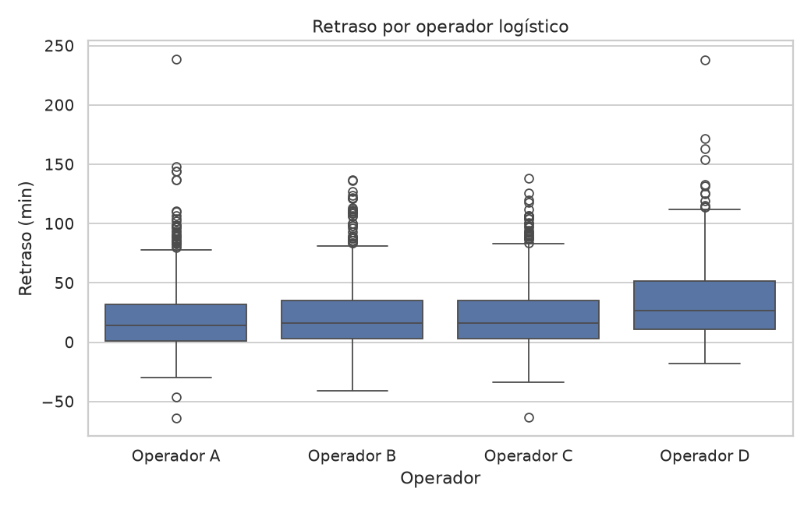
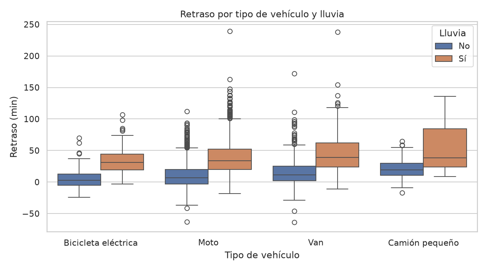
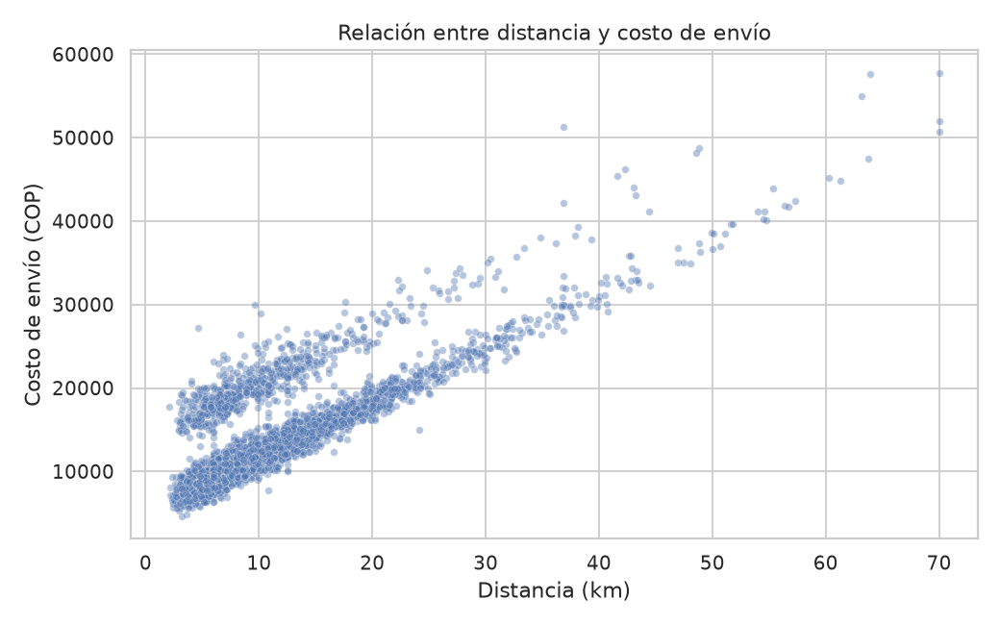
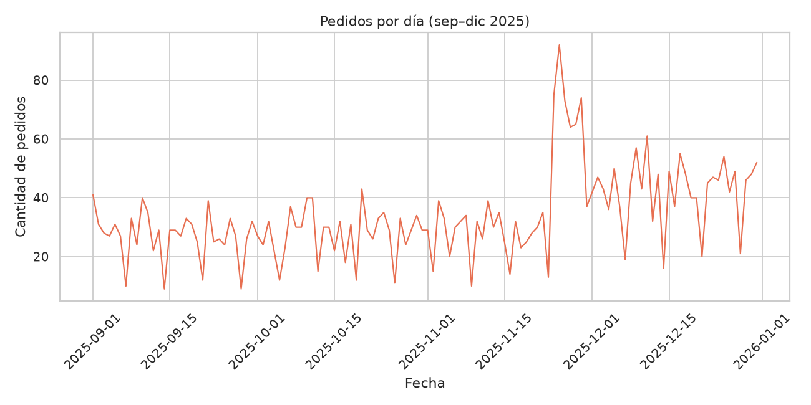
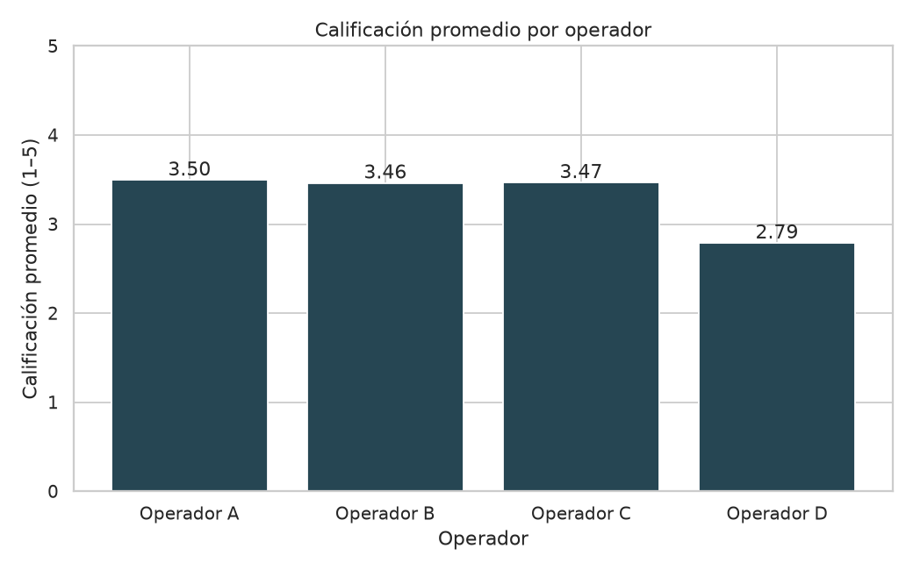
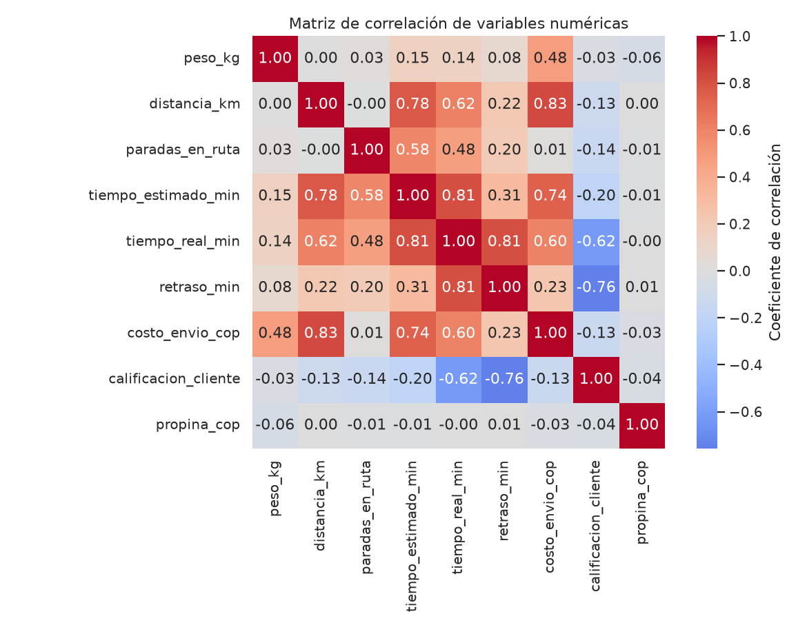

[README-entregable-2.md](https://github.com/user-attachments/files/35056442/README-entregable-2.md)


# Proyecto integrador — Grupo 3: Entregas de última milla en el Valle de Aburrá (2025)

> **Este archivo es el `README.md` final del repositorio** (Entregable 1 + Entregable 2).
> Se pega tal cual en GitHub, reemplazando el README del Entregable 1.
> Antes de pegarlo, reemplaza los dos nombres de los integrantes por los reales.

## Integrantes

- **Wolfang Pérez** — usuario de GitHub: `Wolfang-Perez`
- **Juan Blanco** — usuario de GitHub: `JuanBlanco19`

**Curso:** Programación científica
**Entregable 2:** visualización con Matplotlib y Seaborn, y exposición (20 %)
**Notebook:** [`notebooks/analisis.ipynb`](notebooks/analisis.ipynb)

## El conjunto de datos

La **última milla** es el último tramo de una entrega: de la bodega a la puerta del
cliente. Es el tramo más caro y el que más se retrasa. Cada fila del archivo es
**un pedido** de una tienda en línea, entregado por uno de cuatro operadores
logísticos en los municipios del Valle de Aburrá entre septiembre y diciembre de
2025 (incluye la temporada de Black Friday y Navidad).

- **Archivo:** `data/logistica_entregas_valle_aburra_2025.csv`
- **Tamaño:** 4.100 filas × 21 columnas
- **Origen:** datos **sintéticos**, generados para el curso a partir de fenómenos
  reales de Colombia. Los lugares existen, las cifras no: las conclusiones valen
  para el dataset, no para la realidad.

**Decisión que apoya:** la tienda debe decidir con qué operador renovar el
contrato, qué vehículo asignar según el pedido y en qué franjas o temporadas
reforzar la operación para reducir retrasos y mejorar la calificación del cliente.

### Resumen de las columnas

| Columna | Tipo | Descripción |
|---|---|---|
| `id_pedido` | texto | Identificador del pedido. |
| `fecha` | fecha (AAAA-MM-DD) | Día de la entrega. |
| `dia_semana` | categórica | Día de la semana. |
| `franja_horaria` | categórica | `Mañana`, `Tarde` o `Noche`. |
| `municipio_destino` | categórica | Municipio del cliente. |
| `canal_compra` | categórica | `App`, `Web`, `WhatsApp`, `Teléfono`. |
| `categoria_producto` | categórica | `Alimentos`, `Farmacia`, `Ropa`, `Electrónica`, `Hogar`. |
| `peso_kg` | numérica (kg) | Peso del paquete. |
| `distancia_km` | numérica (km) | Distancia de la bodega al cliente. |
| `tipo_vehiculo` | categórica | `Moto`, `Bicicleta eléctrica`, `Van`, `Camión pequeño`. |
| `operador` | categórica | Operador logístico (A, B, C, D). |
| `paradas_en_ruta` | entero | Entregas que hizo el vehículo en esa ruta. |
| `lluvia` | categórica | `Sí` si llovió durante la entrega. |
| `tiempo_estimado_min` | numérica (min) | Tiempo prometido al cliente. |
| `tiempo_real_min` | numérica (min) | Tiempo que tardó realmente. **Vacío si la entrega falló.** |
| `retraso_min` | numérica (min) | `tiempo_real_min − tiempo_estimado_min` (negativo = llegó antes). **Vacío si la entrega falló.** |
| `estado_entrega` | categórica | `A tiempo`, `Con retraso` (más de 15 min), `Fallido`, `Devuelto`. |
| `motivo_no_entrega` | categórica | Motivo del fallo o la devolución. **Vacío si el pedido se entregó.** |
| `costo_envio_cop` | numérica (pesos) | Costo del envío. |
| `calificacion_cliente` | numérica (1-5) | Calificación que dejó el cliente (no todos califican). |
| `propina_cop` | numérica (pesos) | Propina dejada al repartidor. |

## Preguntas de análisis

1. ¿Qué operador tiene más retrasos y fallos? ¿Y la peor calificación?
2. ¿Cuánto aumenta el retraso cuando llueve? ¿Afecta igual a todos los vehículos?
3. ¿Cómo cambia el volumen de pedidos y el retraso en Black Friday y diciembre?
4. ¿Qué relación hay entre la distancia, el peso y el costo del envío?
5. ¿El retraso explica la calificación del cliente?

## Calidad de los datos y limpieza

### Faltantes: dos tipos que no se tratan igual

| Tipo de faltante | Columnas | Decisión |
|---|---|---|
| **"No aplica"** (el vacío tiene significado) | `motivo_no_entrega` 92,49 % · `propina_cop` 77,39 % · `calificacion_cliente` 27,02 % · `tiempo_real_min` 5,10 % · `retraso_min` 5,10 % | **No se imputan** |
| **Reales** (el dato se perdió) | `peso_kg` 6,02 % · `canal_compra` 5,44 % · `distancia_km` 2,73 % | Se imputan con criterio |

Los vacíos de `motivo_no_entrega` coinciden **exactamente** con los 3.792 pedidos
entregados (1.791 "A tiempo" + 2.001 "Con retraso"): no es un dato perdido, es
"no aplica". Lo mismo pasa con `tiempo_real_min` y `retraso_min`, cuyos 209 vacíos
son los 209 pedidos `Fallido`.

### Tabla de decisiones

| Columna | Problema | % afectado | Decisión | Justificación |
|---|---|---|---|---|
| `id_pedido` | 0 repetidos | 0 % | Conservar | Es la llave de cada pedido. |
| `fecha` | Se leyó como texto (`object`) | 100 % | Convertir a `datetime` | Sin fecha no se puede filtrar por rango (Black Friday, diciembre) ni agrupar por día o mes. |
| `dia_semana` | Coherente con `fecha` | 0 % | Conservar | 0 inconsistencias al recalcular el día desde la fecha. |
| `franja_horaria` | Sin problemas | 0 % | Conservar | Se usa en el análisis. |
| `municipio_destino` | Sin problemas | 0 % | Conservar | Define la distancia y el costo. |
| `canal_compra` | Faltantes reales | 5,44 % (223) | Imputar con la **moda** ("App", 1.746) | Es categórica: la moda es el valor más frecuente y no inventa un número. |
| `categoria_producto` | Sin problemas | 0 % | Conservar | Es el grupo para imputar el peso. |
| `peso_kg` | 247 faltantes + 3 centinelas (`999` y `350` kg) | 6,10 % (250) | Centinelas → `NaN`; mediana **por `categoria_producto`** | El peso depende de la categoría (mediana 0,77 kg en Farmacia vs 9,20 kg en Hogar; general 3,16 kg). 350 kg en una moto y 999 kg son imposibles. |
| `distancia_km` | 112 faltantes + 3 imposibles (`0`, `250`, `480` km) | 2,80 % (115) | Imposibles → `NaN`; mediana **por `municipio_destino`** | La distancia depende del municipio (6,0 km en Medellín vs 36,85 km en Barbosa; general 8,7 km). El Valle de Aburrá mide ~70 km. |
| `tipo_vehiculo` | Sin problemas | 0 % | Conservar | Explica el efecto de la lluvia. |
| `operador` | Desbalance (A 1.299 vs D 667) | — | Conservar y reportar `count` | El desbalance se controla mostrando cuántos casos hay en cada promedio. |
| `paradas_en_ruta` | Sin problemas | 0 % | Conservar | Aporta al tiempo real. |
| `lluvia` | Sin problemas | 0 % | Conservar | Es el factor del que más depende el retraso. |
| `tiempo_estimado_min` | Sin problemas | 0 % | Conservar | Base del cálculo del retraso. |
| `tiempo_real_min` | 209 vacíos = pedidos fallidos | 5,10 % | **No imputar** | "No aplica": si la entrega falló, no hubo tiempo real. Imputar inventaría un dato. |
| `retraso_min` | 209 vacíos = pedidos fallidos | 5,10 % | **No imputar** | Igual que el anterior: sin tiempo real no hay retraso. |
| `estado_entrega` | Sin problemas | 0 % | Conservar | Es la variable de resultado del negocio. |
| `motivo_no_entrega` | 92,49 % de vacíos | 92,49 % | **No eliminar y no imputar** | Los 3.792 vacíos son exactamente las entregas exitosas; entre las 308 no exitosas hay 7 motivos (`Cliente ausente` 102, `Dirección incorrecta` 49, `Zona de difícil acceso` 40, `Producto dañado` 35, `Pedido equivocado` 33, `Cliente rechazó` 31, `Vehículo averiado` 18). Es la única fuente que dice **por qué** falla una entrega. |
| `costo_envio_cop` | Sin problemas | 0 % | Conservar | Es la variable de costo a explicar. |
| `calificacion_cliente` | 1.108 vacíos = el cliente no calificó | 27,02 % | **No imputar** | "No aplica": imputar una nota inventaría opiniones. |
| `propina_cop` | 3.173 vacíos = no dejó propina | 77,39 % | **No eliminar y no imputar** | El vacío significa "propina = 0", no un dato perdido; la columna entra en el mapa de calor de correlaciones. |

### Costo de las decisiones

| Columna | Faltantes iniciales | Centinelas → `NaN` | Valores imputados | Estrategia |
|---|---|---|---|---|
| `canal_compra` | 223 | 0 | **223** | Moda |
| `peso_kg` | 247 | 3 | **250** | Mediana por `categoria_producto` |
| `distancia_km` | 112 | 3 | **115** | Mediana por `municipio_destino` |
| **Total** | **582** | **6** | **588** | — |

- **Filas antes:** 4.100 → **filas después:** 4.100 (**0 eliminadas**).
- **Columnas eliminadas:** 0 (las dos con más faltantes se conservan con
  justificación).
- **Valores imputados:** 588 (14,3 % del dataset).
- Se conservan los 243 pedidos `Fallido`/`Devuelto` que **sí** tienen
  `calificacion_cliente`: se documenta como inconsistencia semántica, pero no se
  borran porque son evidencia real.

### Otras verificaciones

- **Duplicados:** 0 filas duplicadas y 0 `id_pedido` repetidos.
- **Coherencia fecha ↔ día:** 0 inconsistencias.
- **Coherencia del retraso:** `retraso_min = tiempo_real_min − tiempo_estimado_min`
  en las 3.891 filas con dato, sin excepciones.
- **Coherencia del estado:** `A tiempo` nunca pasa de 15 min de retraso y
  `Con retraso` siempre pasa de 15 min (0 excepciones).
- **Categorías escritas de varias formas:** 0 variantes por espacios o mayúsculas
  en las diez columnas categóricas.

## Hallazgos

### 1. ¿Qué operador tiene más retrasos y fallos? ¿Y la peor calificación?

| Operador | Pedidos | Retraso promedio (min) | % con retraso | % fallido/devuelto | Calificación | N.º de calificaciones |
|---|---|---|---|---|---|---|
| A | 1.299 | 18,35 | 44,34 % | 7,78 % | **3,50** | 935 |
| B | 1.107 | 21,61 | 48,33 % | **5,69 %** | 3,46 | 830 |
| C | 1.027 | 20,28 | 46,84 % | 6,82 % | 3,47 | 724 |
| D | 667 | **34,18** | **61,32 %** | **11,09 %** | **2,79** | 503 |

El operador **D es el peor en las cuatro dimensiones**: casi el doble de retraso que
A (34,18 vs 18,35 min), el mayor porcentaje con retraso (61,32 %) y de
fallidos/devueltos (11,09 %), y la peor calificación (2,79 frente a ~3,5). A es el
mejor en tiempo y nota; B el que menos falla.

### 2. ¿Cuánto aumenta el retraso cuando llueve? ¿Afecta igual a todos los vehículos?

| Lluvia | Pedidos | Retraso promedio (min) | % con retraso |
|---|---|---|---|
| No | 2.479 | 10,93 | 30,46 % |
| Sí | 1.621 | **39,78** | **76,87 %** |

La lluvia **casi cuadruplica** el retraso (+28,85 min) y más que duplica el
porcentaje de pedidos con retraso. Afecta a **todos** los vehículos: bicicleta
eléctrica +28,08 min, moto +28,71, van +29,51 y camión pequeño +31,52. No hay
vehículo "inmune".

### 3. ¿Cómo cambia el volumen de pedidos y el retraso en Black Friday y diciembre?

| Periodo | Pedidos | Retraso promedio (min) | % con retraso |
|---|---|---|---|
| Sep – 27 nov | 2.720 | 21,31 | 47,83 % |
| Black Friday (28 nov) | 65 | **36,10** | **69,23 %** |
| Diciembre | 1.315 | 23,40 | 49,81 % |

El volumen crece mes a mes: **814** (sep) → **862** (oct) → **1.109** (nov) →
**1.315** (dic), un +62 %; el día más cargado fue el **25 de noviembre, con 92
pedidos**. El retraso también sube (23,40 min en diciembre vs 21,31). Black Friday
tiene el peor retraso (36,10 min), pero con solo 65 pedidos: indicativo, no
concluyente.

### 4. ¿Qué relación hay entre la distancia, el peso y el costo del envío?

- **Distancia ↔ costo: r = 0,83** (fuerte).
- **Peso ↔ costo: r = 0,48** (moderada).
- Distancia y peso entre sí: ≈ 0 (ejes independientes del precio).
- Costo de envío promedio: **14.026 COP**.

| Rango de distancia (km) | Pedidos | Costo promedio (COP) |
|---|---|---|
| 0 – 5 | 575 | 9.390 |
| 5 – 10 | 1.873 | 11.553 |
| 10 – 20 | 1.222 | 15.854 |
| 20 – 40 | 375 | 23.807 |
| 40 – 100 | 55 | 39.389 |

La **distancia manda en el costo**: el costo se multiplica por ~4 entre el tramo
más corto y el más largo. El peso influye, pero menos.

### 5. ¿El retraso explica la calificación del cliente?

| Estado | Pedidos | Calificación promedio | N.º de calificaciones |
|---|---|---|---|
| A tiempo | 1.791 | **4,29** | 1.100 |
| Con retraso | 2.001 | 3,03 | 1.649 |
| Devuelto | 99 | 2,10 | 78 |
| Fallido | 209 | **1,06** | 165 |

| Tramo de retraso (min) | Calificaciones | Promedio |
|---|---|---|
| ≤ −30 | 8 | 4,25 |
| −30 a 0 | 472 | 4,40 |
| 0 a 15 | 658 | 4,11 |
| 15 a 30 | 700 | 3,62 |
| 30 a 60 | 697 | 2,91 |
| > 60 | 292 | **1,71** |

**r = −0,76**: el retraso **sí explica** en buena medida la calificación, y el
descenso es monótono tramo a tramo. Entre un pedido puntual (4,40) y uno con más de
una hora de retraso (1,71) hay **2,7 puntos** de diferencia.

## Visualizaciones

Las **diez** gráficas están en [`visualizaciones/`](visualizaciones/) como PNG con
nombre descriptivo, y también quedan ejecutadas dentro del notebook (se ven al
abrirlo). Aquí van todas, en el orden en que se generan: cuatro univariadas y seis
multivariadas.

### Distribución del retraso



La distribución es **asimétrica a la derecha**: mediana de **17 min**, el 25 % de
los pedidos llega en ≤ 4 min y el 75 % en ≤ 36 min, pero una cola larga llega a
**239 min**. La mayoría cumple el compromiso; el problema se concentra en una
minoría con retrasos muy altos.

### Pedidos por estado de entrega



De los 4.100 pedidos, **2.001 (48,8 %) llegaron con retraso**, 1.791 (43,7 %) a
tiempo, 209 (5,1 %) fallidos y 99 (2,4 %) devueltos. Casi la mitad de la operación
incumple el compromiso de tiempo.

### Pedidos por municipio



La demanda se concentra en **Medellín (1.750 pedidos, 42,7 %)**, seguido de Bello
(553) y Envigado (408). La operación debe priorizarse en el corredor
Medellín–Bello–Envigado–Itagüí.

### Peso de los pedidos



La mitad de los pedidos pesa entre **1,48 y 5,88 kg**, con mediana de **3,25 kg**.
La caja es estrecha y la cola de valores altos llega a **48,4 kg**: son 42 pedidos de
más de 20 kg, 40 de ellos del segmento **Hogar** (mediana 9,20 kg). El peso no
depende de la distancia, pero sí del tipo de producto.

### Retraso por operador



La caja del **operador D** está más alta y más dispersa que las de A, B y C, que se
agrupan más abajo. Es la evidencia visual del hallazgo 1: D es el eslabón débil.

### Retraso por vehículo y lluvia



Para **todos** los vehículos la caja con lluvia ("Sí") sube respecto a la seca
("No"). La bicicleta eléctrica pasa de ≈ 5,6 a ≈ 33,7 min de retraso promedio y la
moto de ≈ 10,3 a ≈ 39,0. La lluvia es un factor transversal.

### Distancia y costo de envío



La nube es una **diagonal ascendente** (r = 0,83): a mayor distancia, mayor costo.
De ≈ 9.390 COP en 0–5 km a ≈ 39.389 COP en 40–100 km. La distancia es la variable
que debe sostener el precio del envío.

### Pedidos por día



El volumen crece a lo largo del cuatrimestre (814 en septiembre → 1.315 en
diciembre), con el **pico el 25 de noviembre (92 pedidos)**. La capacidad extra se
necesita en noviembre y diciembre, no todo el año.

### Calificación promedio por operador



Con las calificaciones válidas (2.992 de 4.100), A, B y C quedan casi empatados
(**3,50 / 3,46 / 3,47**) y **D cae a 2,79**: medio punto por debajo. Es la misma
conclusión del hallazgo 1, pero medida por la opinión del cliente y no por el reloj.

### Mapa de calor de correlaciones



Las relaciones más fuertes: `retraso_min` ↔ `calificacion_cliente` **−0,76**;
`distancia_km` ↔ `costo_envio_cop` **0,83**; `tiempo_real_min` ↔ `retraso_min`
**0,81**; `peso_kg` ↔ `costo_envio_cop` **0,48**. Correlación no implica causa:
solo muestra qué variables se mueven juntas.

## Conclusiones y recomendaciones

**Respuesta a cada pregunta:**

1. **Operador:** D es el peor (34,18 min de retraso, 61,32 % con retraso, 11,09 %
   fallidos/devueltos, 2,79 de calificación); A es el mejor en tiempo y nota; B es
   el que menos falla.
2. **Lluvia:** sube el retraso de 10,93 a 39,78 min y el % con retraso de 30,46 % a
   76,87 %; afecta a todos los vehículos por igual (+28 a +32 min).
3. **Temporada:** el volumen crece de 814 (sep) a 1.315 (dic) y el retraso sube;
   Black Friday es el pico de retraso, pero con una muestra pequeña (65 pedidos).
4. **Costo:** la distancia explica el costo (r = 0,83); el peso aporta algo
   (r = 0,48); distancia y peso son independientes.
5. **Satisfacción:** el retraso explica la calificación (r = −0,76): de 4,29 (a
   tiempo) a 1,71 (> 60 min).

**Recomendaciones:**

1. **No renovar el contrato con el operador D** (o renegociarlo con un SLA
   estricto y penalizaciones): es el peor en retraso, en fallos y en calificación,
   y su calificación de 2,79 arrastra la percepción de la tienda.
2. **Reforzar la capacidad en noviembre y diciembre**, en especial alrededor del
   Black Friday y del 25 de noviembre: ahí se concentran el volumen (1.315 pedidos
   en diciembre) y el retraso (23,40 min).
3. **Plan de lluvia con holgura de tiempo**: cuando llueve el retraso sube +28,85
   min y el 76,87 % de los pedidos se retrasa. Ajustar los tiempos prometidos o
   sumar vehículos esos días evita prometer lo que no se puede cumplir.
4. **Atacar las causas de no entrega**: `Cliente ausente` (102) y `Dirección
   incorrecta` (49) son la mitad de los 308 fallos. Confirmar dirección y avisar al
   cliente antes de despachar reduce fallos y devoluciones.
5. **Usar la distancia como base del precio del envío** (r = 0,83): es la variable
   que mejor explica el costo y la que permite cotizar con criterio.

## Limitaciones

- **Los datos son sintéticos.** Se generaron para el curso a partir de fenómenos
  reales de Colombia: los lugares existen, las cifras no. Las conclusiones valen
  para el dataset, no para la realidad.
- **Faltantes no imputados.** El 27,02 % de los pedidos no tiene calificación y el
  77,39 % no tiene propina. Se respetó que el vacío significa "no aplica", pero eso
  deja los promedios de calificación calculados sobre una parte de los pedidos, con
  posible **sesgo de autoselección** (quien califica no es una muestra aleatoria).
- **Grupos pequeños.** Black Friday tiene 65 pedidos y el camión pequeño solo 44:
  sus promedios son indicativos y no concluyentes.
- **Correlación no implica causalidad.** Que el retraso y la calificación se muevan
  juntos (r = −0,76) no prueba que el retraso sea la única causa; y la lluvia se
  asocia al retraso, pero podrían existir otras variables (tráfico) que no están en
  el dataset.
- **La lluvia es solo "Sí/No"**, sin intensidad ni duración, así que no se puede
  graduar su efecto.
- **Un solo cuatrimestre.** No hay años anteriores: no se puede separar la
  estacionalidad de una tendencia de largo plazo.

## Cómo ejecutar el notebook

1. Abre `notebooks/analisis.ipynb` (botón **Open in Colab** del encabezado, o
   descárgalo y súbelo a [colab.research.google.com](https://colab.research.google.com)).
2. Sube `data/logistica_entregas_valle_aburra_2025.csv` al panel de archivos de
   Colab (icono de carpeta → subir). El notebook busca el archivo en tres rutas
   relativas, así que funciona si lo dejas en la raíz de Colab.
3. Menú **Entorno de ejecución → Ejecutar todas**. Debe correr de principio a fin
   sin errores.
4. Las gráficas se guardan solas en `visualizaciones/` con `plt.savefig` (se
   regeneran cada vez que corres la sección 6).
5. Para descargarlas a tu computador, agrega una celda al final:

```python
from google.colab import files
for nombre in sorted(os.listdir("visualizaciones")):
    files.download(f"visualizaciones/{nombre}")
```
